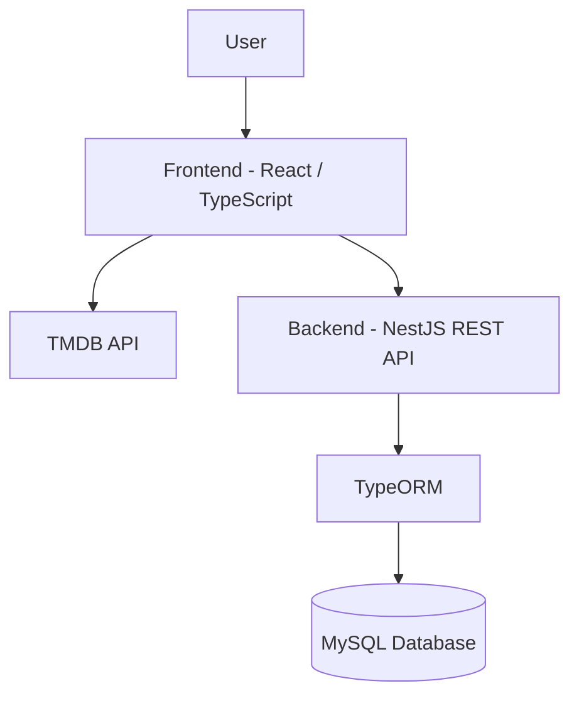

# 🎬 UMCine – Full-Stack Movie Service

> React와 NestJS 기반의 영화 정보 조회, 검색, 평점 및 즐겨찾기 웹 서비스

DKU UMC 11기 개발 스터디를 통해 진행한 프로젝트로, Frontend와 Backend 전반의 웹 서비스 개발 기술을 학습하고 적용했습니다.

## 📌 Project Overview

- **Period:** 2026.09 ~ Present
- **Activity:** DKU UMC 11th
- **Domain:** Full-Stack Web Development
- **Project:** 영화 정보 및 사용자 기반 영화 기록 서비스

## 🛠️ Tech Stack

### Frontend


- React / TypeScript / Vite
- TanStack Query / TanStack Router
- TMDB API

### Backend


- NestJS / TypeScript
- MySQL / TypeORM
- JWT / bcrypt
- Jest

### Development Tools


---

## ✨ Main Features

| 기능 | 설명 |
|---|---|
| 영화 정보 조회 | TMDB API 기반 영화 목록 및 상세 정보 조회 |
| 영화 검색 | 사용자 검색어 기반 영화 탐색 |
| 회원가입 | 입력값 유효성 검사 및 중복 확인 |
| 로그인 | JWT 기반 사용자 인증 |
| 프로필 관리 | 사용자 정보 조회 및 수정 |
| 영화 평점 | 영화 평점 등록, 조회, 수정 및 삭제 |
| 즐겨찾기 | 사용자별 영화 즐겨찾기 관리 |
| API 응답 표준화 | 제네릭 기반 공통 API 응답 구조 적용 |

---

## 🏗️ System Architecture



- **Frontend:** 사용자 인터페이스 및 외부 API 연동
- **Backend:** REST API, 사용자 인증 및 비즈니스 로직 처리
- **Database:** 회원, 평점, 즐겨찾기 데이터 관리
- **External API:** TMDB 기반 영화 정보 제공

---

## 📂 Project Structure

```text
UMCine/
├── frontend/
│   ├── public/
│   ├── src/
│   │   ├── api/
│   │   ├── components/
│   │   ├── config/
│   │   ├── hooks/
│   │   ├── pages/
│   │   ├── routes/
│   │   ├── stores/
│   │   ├── types/
│   │   └── utils/
│   ├── .env.example
│   └── package.json
│
├── backend/
│   ├── database/
│   ├── src/
│   │   ├── common/
│   │   ├── controller/
│   │   ├── dto/
│   │   ├── entity/
│   │   ├── exception/
│   │   ├── filter/
│   │   ├── guard/
│   │   └── service/
│   ├── test/
│   ├── .env.example
│   └── package.json
│
├── .gitignore
└── README.md
```

---

## 🚀 Getting Started

### Clone Repository

```bash
git clone https://github.com/choi-woo-hyeok/UMCine.git
cd UMCine
```

### Frontend

```bash
cd frontend
pnpm install
pnpm dev
```

실행 전 `.env.example`을 참고하여 `.env.local` 파일을 생성하고 다음 환경 변수를 설정합니다.

```env
VITE_TMDB_API_BASE_URL=https://api.themoviedb.org/3
VITE_TMDB_ACCESS_TOKEN=YOUR_TMDB_TOKEN
VITE_API_BASE_URL=http://localhost:3000
```

### Backend

```bash
cd backend
npm install
npm run start:dev
```

실행 전 `.env.example`을 참고하여 `.env` 파일을 생성합니다.

```env
DB_HOST=localhost
DB_PORT=3306
DB_USER=YOUR_DB_USER
DB_PASSWORD=YOUR_DB_PASSWORD
DB_NAME=YOUR_DB_NAME
JWT_SECRET=YOUR_JWT_SECRET
JWT_ACCESS_EXPIRATION=3600
```

MySQL 데이터베이스 및 필요한 테이블을 사전에 구성해야 합니다.

---

## 🔐 Security & Data Integrity

- 환경 변수를 활용한 API 인증 정보 및 DB 접속 정보 분리
- bcrypt 기반 비밀번호 해싱 및 검증
- JWT 기반 사용자 인증
- 회원가입 입력값 유효성 검사 및 중복 검증
- TypeORM `synchronize: false` 설정을 통한 의도하지 않은 DB 스키마 변경 방지
- 공통 API 응답 구조 및 예외 처리
- `.gitignore`를 활용한 민감 정보 업로드 방지

---

## 🔧 Troubleshooting

### 01. API 인증 정보 관리

**Problem**

외부 API 연동 과정에서 인증 정보를 소스 코드에 직접 작성할 경우 GitHub 저장소에 노출될 위험이 있었습니다.

**Solution**

환경 변수 파일과 `.gitignore`를 활용하여 실제 인증 정보와 소스 코드를 분리하고, `.env.example`을 통해 필요한 환경 변수 구조를 제공했습니다.

### 02. 회원 데이터 유효성 검증

**Problem**

회원가입 과정에서 잘못된 입력값이나 중복된 이메일 및 닉네임이 등록될 가능성이 있었습니다.

**Solution**

Frontend의 정규표현식 기반 입력값 검증과 Backend의 이메일·닉네임 중복 확인을 분리하여 데이터 무결성을 고려했습니다.

### 03. API 응답 구조 표준화

**Problem**

API별 응답 구조가 달라질 경우 클라이언트의 데이터 처리 로직이 복잡해질 수 있었습니다.

**Solution**

TypeScript 제네릭 기반의 `ApiResponse<T>`를 적용하여 API 응답 형식의 일관성을 확보했습니다.

---

## 📚 What I Learned

- React 기반 컴포넌트 설계 및 서버 상태 관리
- 외부 API 연동 및 비동기 데이터 처리
- NestJS 기반 계층형 아키텍처
- REST API 설계 및 CRUD 구현
- 관계형 데이터베이스와 ORM
- JWT 인증 및 비밀번호 보안
- 소프트웨어 테스트 및 예외 처리
- Git 기반 소스 코드 관리

---

## 📖 About

본 프로젝트는 DKU UMC 11기 개발 스터디의 학습 및 실습 결과물이며, 지속적인 기능 개선과 코드 리팩토링을 목표로 합니다.
